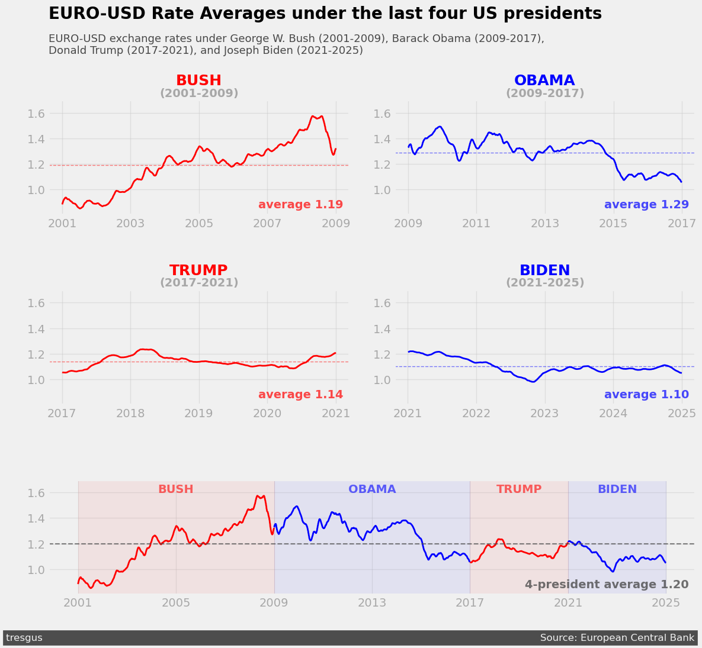

# Euro-Dollar Exchange Rates under Four US Presidents

An explanatory data visualization project that tracks the euro-to-US-dollar exchange rate from 2001 to 2025 and compares how it moved under George W. Bush, Barack Obama, Donald Trump (first term) and Joe Biden.



## Key findings

| President | Years | Average rate (USD per €1) | Pattern |
|---|---|---|---|
| Bush | 2001–2009 | 1.19 | Steady climb from about 0.85 to an all-time high near 1.58 in 2008, then a sharp drop |
| Obama | 2009–2017 | **1.29** | Stayed high (1.25–1.50) for most of the term, then fell steeply from 2014 to about 1.05 |
| Trump | 2017–2021 | 1.14 | The most stable period, staying between about 1.05 and 1.25 |
| Biden | 2021–2025 | 1.10 | Started near 1.22, dropped below parity (1.00) in late 2022, then recovered to about 1.10 |

- **The biggest moves line up with global events, not with changes in president:** the 2008 financial crisis, the ECB's 2014–2015 quantitative easing, and the 2022 energy crisis and Federal Reserve rate hikes.
- **The euro has trended weaker over the last decade** and has not returned to its 2008 peak.
- **Political party shows no clear pattern** in the exchange rate.

## Design approach

The chart applies information design principles for a general audience:

- **Audience familiarity:** simple line charts with plain-language labels.
- **Data-ink ratio:** faded tick labels, light gridlines and no chart borders.
- **Gestalt principles:** color by party (similarity), shaded term regions (enclosure) and grouped small multiples (proximity).
- **Pre-attentive attributes:** color, bold text and size draw attention to each president's name and average.

## Method

1. Kept the US dollar column and converted the dates to datetime.
2. Dropped 62 days with no published rate (`-`).
3. Smoothed the daily rate with a 30-day rolling mean.
4. Split the data by presidential term (approximated by calendar year) and plotted each term with its average.

## Data

Daily euro reference rates from the **European Central Bank**, compiled by Daria Chemkaeva on Kaggle:
[Euro daily exchange rates dataset on Kaggle](https://www.kaggle.com/datasets/lsind18/euro-exchange-daily-rates-19992020)

The version used here was downloaded in November 2026 and covers January 1999 to June 2026. The data is not included in this repository.

## Running the notebook

1. Download the CSV from the Kaggle link above and save it as `data/euro-daily-hist_1999_.csv`.
2. Install the dependencies:
   ```bash
   pip install pandas matplotlib numpy jupyter
   ```
3. Open `euro-dollar-exchange.ipynb` and run all cells.

## Tools

Python 3.13, pandas, matplotlib, NumPy, Jupyter
